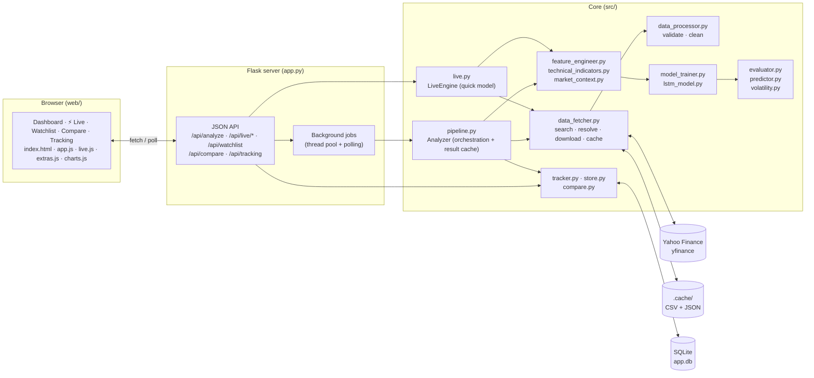
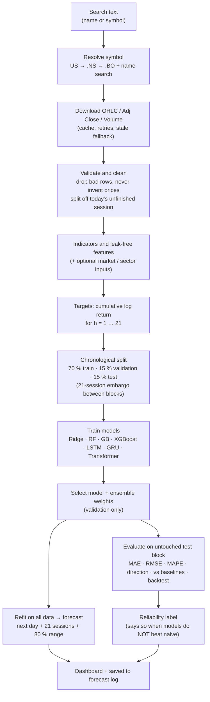
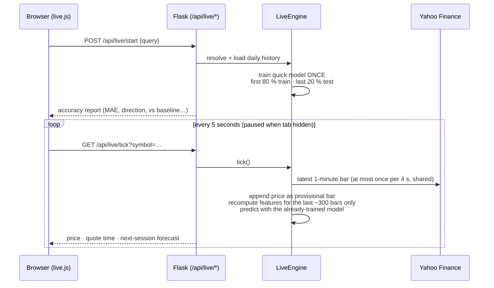

# 📈 Stock Trend Predictor `v2.2`

An end-to-end stock analysis and forecasting web app for **Indian and US stocks**. It downloads real daily history
from **Yahoo Finance (`yfinance`)**, trains machine-learning and deep-learning models on it, tests them on data they
never saw, and shows next-day and next-month forecasts with uncertainty ranges, plus a live-price view that updates
every 5 seconds.

> ⚠️ **Disclaimer.** Forecasts are statistical estimates, **not** guaranteed outcomes and **not** investment advice.
> For most stocks, models do **not** reliably beat the naive "price stays the same" baseline. The app measures this on
> held-out data and tells you when that is the case. Prices come from Yahoo Finance and may be delayed; the app never
> labels them real-time.

---

## Table of contents
1. [Features](#1-features)
2. [Tech stack](#2-tech-stack)
3. [Project architecture](#3-project-architecture)
4. [Data and model pipeline](#4-data-and-model-pipeline)
5. [Live price and quick forecast](#5-live-price-and-quick-forecast)
6. [Project structure](#6-project-structure)
7. [Installation](#7-installation)
8. [How to use](#8-how-to-use)
9. [Configuration](#9-configuration)
10. [API reference](#10-api-reference)
11. [Models and features](#11-models-and-features)
12. [Validation and evaluation](#12-validation-and-evaluation)
13. [Data honesty and safeguards](#13-data-honesty-and-safeguards)
14. [Testing](#14-testing)
15. [Troubleshooting](#15-troubleshooting)
16. [Known limitations](#16-known-limitations)
17. [Roadmap ideas](#17-roadmap-ideas)

---

## 1. Features

| Area | What you get |
|---|---|
| **Search** | Company name or symbol (`RELIANCE.NS`, `TCS.NS`, `INFY.BO`, `AAPL`, `Reliance Industries`). Bare symbols are tried as US, then `.NS`, then `.BO`; other matches are shown so you can switch. |
| **Real data** | Open, High, Low, Close, Adjusted Close, Volume from Yahoo Finance. No hard-coded, fake or random prices. |
| **Analysis** | Returns, volatility, SMA/EMA, RSI, MACD, Bollinger Bands, ATR, OBV, drawdown, trend summary. |
| **Forecast** | Next trading day and ~21 sessions ahead, per model, with 80 % ranges. |
| **Models** | Ridge, Random Forest, Gradient Boosting, XGBoost (optional), LSTM, GRU, Transformer (needs PyTorch), plus an ensemble and naive/drift baselines. |
| **Evaluation** | MAE, RMSE, MAPE, directional accuracy, error versus baselines, interval coverage, long/flat backtest with trading costs, a plain-language reliability label. |
| **Live tab** ⚡ | Current price refreshed every 5 s; a quick model trained once (80/20 split) that predicts from each new price **without retraining**; accuracy shown. |
| **Watchlist** ★ | Save stocks; one page shows price, change and the next-day / month-end forecast. |
| **Compare** | 2–4 stocks rebased to 100, drawdown chart, returns, volatility, correlation. |
| **Forecast tracking** | Every forecast is saved; once its date passes, the real close is recorded so you see real-world accuracy over time. |
| **Market and sector inputs** | Nifty / Sensex, India VIX, USD/INR, crude oil (or S&P 500, VIX, rates for US stocks) plus the stock's sector index, with no look-ahead. |
| **Tuned models** | Optional per-stock hyper-parameter search using time-aware validation. |
| **Volatility forecast** | 5 / 10 / 21-session volatility versus "stays the same" and EWMA baselines. |
| **Robustness** | Symbol validation, missing-data handling, API-failure messages, stale-cache fallback, exchange holidays, loading indicators, manual refresh. |

---

## 2. Tech stack

| Layer | Technology |
|---|---|
| Language | Python 3.10+ |
| Data provider | `yfinance` (Yahoo Finance) |
| Data handling | `pandas`, `numpy` |
| Classical ML | `scikit-learn` (Ridge, RandomForest, HistGradientBoosting), `xgboost` (optional) |
| Deep learning | PyTorch (optional) or a built-in NumPy LSTM/GRU (gradient-checked) |
| Backend | Flask (JSON API + background jobs) |
| Storage | CSV/JSON price cache, SQLite (watchlist, forecast log) |
| Frontend | Plain HTML, CSS, JavaScript, with a custom dependency-free SVG chart library (no CDN needed) |
| Calendars | `holidays` (optional) for NSE / NYSE closures |
| Tests | `pytest` or the bundled runner |

---

## 3. Project architecture



**Design principles**
- **Thin web layer, fat core.** `app.py` only validates requests and returns JSON; all logic lives in `src/` and is unit-tested without a server.
- **Long work runs in the background.** Full analysis starts a job; the browser polls `/api/jobs/<id>` and shows a progress bar.
- **Everything is cached.** Price downloads (60 min TTL, stale-cache fallback if Yahoo is down) and full analysis results (keyed by symbol + last bar + settings) so unchanged data never retrains.
- **No leakage.** Chronological splits with an embargo, scalers fit on training rows only, market inputs lagged when needed.

---

## 4. Data and model pipeline



| Stage | Module | Notes |
|---|---|---|
| Data collection | `data_fetcher.py` | Search, symbol resolution, download, CSV cache, clear error classification. |
| Preprocessing | `data_processor.py` | Validation, gap/staleness/jump warnings, removes bad rows without filling, separates the in-progress session. |
| Indicators | `technical_indicators.py` | SMA/EMA, RSI, MACD, Bollinger, ATR, OBV, trend summary. |
| Features | `feature_engineer.py`, `market_context.py` | Leak-free features on adjusted prices; optional market/sector inputs. |
| Models | `model_trainer.py`, `lstm_model.py` | One multi-horizon model per algorithm, optional tuning, ensemble. |
| Evaluation | `evaluator.py` | Metrics, baselines, interval coverage, backtest, reliability label. |
| Forecast | `predictor.py` | Price paths and ranges on future sessions (holiday-aware). |
| Volatility | `volatility.py` | Multi-horizon volatility forecast with baselines. |
| Tracking | `tracker.py`, `store.py` | Logs forecasts, resolves outcomes, summarises real accuracy. |
| Orchestration | `pipeline.py` | Ties it together, caches results, builds the JSON payload. |

---

## 5. Live price and quick forecast

The **⚡ Live** tab is built so a 5-second refresh stays cheap: the model is trained once and each refresh only adds
the newest price.



- **Trained once:** Ridge vs a small gradient-boosting model, chosen on a validation slice *inside* the 80 %. The last 20 % is used only to report accuracy.
- **No retraining on a new price:** only the tail of recent bars is recomputed (tested to equal a full recompute). If the price did not change, the cached forecast is returned.
- **Only close-based features** are used, so an unfinished intraday bar cannot distort them.
- **Shown with the accuracy:** error versus "tomorrow = today", up/down hit rate versus always guessing "up", 80 % range coverage. If the model does not beat the baseline, the page says so.
- Yahoo's latest bar is shown with its own timestamp and age. It can be delayed and often will not change every 5 seconds.

---

## 6. Project structure

```text
Stock-Trend-Predictor/
├── app.py                      # Flask server: JSON API + dashboard
├── main.py                     # Command-line interface
├── requirements.txt            # Dependencies
├── setup.bat / quick_launch.bat# Windows helpers
├── config/
│   └── config.yaml             # All settings (port, models, split, live, market inputs)
├── src/
│   ├── data_fetcher.py         # yfinance search / download / cache / live quote
│   ├── data_processor.py       # Validation and cleaning
│   ├── technical_indicators.py # Indicators and trend summary
│   ├── feature_engineer.py     # Leak-free features and targets
│   ├── market_context.py       # Index / VIX / FX / commodity / sector inputs
│   ├── lstm_model.py           # LSTM, GRU (NumPy + PyTorch), Transformer (PyTorch)
│   ├── model_trainer.py        # Models, splits, tuning, ensemble
│   ├── evaluator.py            # Metrics, baselines, backtest, reliability
│   ├── predictor.py            # Forecast paths and future session dates
│   ├── volatility.py           # Volatility forecasting
│   ├── pipeline.py             # Orchestration and result cache
│   ├── live.py                 # Live price + quick model engine
│   ├── store.py                # SQLite: watchlist and forecast log
│   ├── tracker.py              # Forecast tracking and real accuracy
│   ├── compare.py              # Multi-stock comparison
│   ├── portfolio_analyzer.py   # Kept from the original project
│   └── utils.py                # Config loader and helpers
├── web/
│   ├── templates/index.html    # Single-page dashboard
│   └── static/                 # app.js · live.js · extras.js · charts.js · style.css
├── tests/                      # Unit and integration tests (offline)
├── sample_data/                # Real Reliance prices from the original project (used by one test only)
├── legacy/                     # Old Tkinter UI, notebooks, old prediction files (not maintained)
└── .cache/                     # Created at run time: price cache, SQLite database
```

---

## 7. Installation

**Requirements:** Python 3.10 or newer, and an internet connection (Yahoo Finance).

```bash
# 1. Create and activate a virtual environment
python -m venv venv
venv\Scripts\activate            # Windows
# source venv/bin/activate       # macOS / Linux

# 2. Install dependencies
pip install -r requirements.txt

# 3. Run the app
python app.py
```

Then open **http://127.0.0.1:5000** in your browser (if the port differs, use the address printed in the terminal).

Windows shortcut: run `setup.bat` once, then `quick_launch.bat`.

**Optional extras** (already listed in `requirements.txt`): `torch` (faster LSTM and enables the Transformer),
`xgboost`, `holidays`. If one is missing the app skips it and tells you; nothing breaks.

---

## 8. How to use

1. **Dashboard:** type a company or symbol, choose a history length, press **Analyze**. Watch the progress bar. Use **Refresh data** to re-download from Yahoo, **Force retrain** to ignore the cache, **Market inputs** to add index/VIX/FX/crude/sector, **Tune models** for a slower per-stock search.
2. **⚡ Live:** enter a stock, press **Start live**. Read the accuracy table first, then watch the price and next-session forecast update. **Pause** stops requests.
3. **★ Watchlist:** add stocks; press **Update forecast** on a row to retrain it.
4. **Compare:** enter 2–4 stocks and press **Compare**.
5. **Forecast tracking:** after forecast dates pass, press **Update outcomes** to see how accurate the app has really been on your stocks.

**Command line**
```bash
python main.py --mode cli --ticker TCS.NS --period 5y        # add --refresh, --retrain, --json
```

---

## 9. Configuration

All settings live in `config/config.yaml`.

| Section | Key settings |
|---|---|
| `app` | `host`, `port` (change it if 5000 is taken), `version` |
| `data` | `default_ticker`, `default_period`, `data_cache_ttl_minutes`, `min_rows`, `stale_after_days` |
| `modeling` | `horizon` (21), `seq_len`, `split` (0.70 / 0.15 / test), `interval_quantiles`, `models`, `use_market_context`, `tune`, `lstm.*` |
| `backtest` | `transaction_cost` (0.1 %) |
| `market_context` | Assets per region (India / US / other) and their lag |
| `live` | `poll_seconds` (5), `min_quote_interval_seconds` (4), `tail_rows` (300), `tail_refresh_seconds` (600), `test_fraction` (0.20), `max_quote_age_minutes` (20) |

---

## 10. API reference

| Method | Endpoint | Purpose |
|---|---|---|
| GET | `/api/health` | Status, version, whether `xgboost` / `torch` are available |
| GET | `/api/search?q=` | Company / symbol search |
| POST | `/api/analyze` | Start a full analysis job → `{job_id}` (body: `query`, `period`, `refresh`, `retrain`, `use_context`, `tune`) |
| GET | `/api/jobs/<id>` | Job progress and result |
| POST | `/api/live/start` | Resolve a stock and train the quick model → `{job_id}` |
| GET | `/api/live/tick?symbol=` | Latest price + next-session forecast (no retraining) |
| GET / POST | `/api/watchlist` | List (with prices) / add a stock |
| DELETE | `/api/watchlist/<symbol>` | Remove a stock |
| POST | `/api/compare` | Compare 2–4 stocks |
| GET | `/api/tracking` | Forecast-tracking summary |
| POST | `/api/tracking/resolve` | Fill in outcomes for forecasts whose date has passed |

Errors are JSON: `{"error": {"code": "...", "message": "..."}}` with a suitable HTTP status. Stack traces are never sent to the browser.

---

## 11. Models and features

| Model | Type | Notes |
|---|---|---|
| Ridge Regression | ML | Fast linear baseline model |
| Random Forest | ML | Non-linear, robust |
| Gradient Boosting | ML | `HistGradientBoostingRegressor`, one model per horizon |
| XGBoost | ML | Optional (`pip install xgboost`) |
| LSTM / GRU | DL | PyTorch if installed, otherwise built-in NumPy (gradient-checked) |
| Transformer | DL | Needs PyTorch |
| Ensemble | Blend | Best 3 models, weights from validation error only |
| Naive / drift | Baselines | "Price stays the same" and "recent average drift" |

**Targets:** cumulative log return for each horizon h = 1 … 21 (multi-output, direct forecasting).

**Features (all from data available at the time):** returns over 1–60 days, price versus SMA 5/10/20/50, SMA and EMA
crossovers, RSI, MACD, Bollinger %B and width, ATR, rolling volatility, volume z-score and OBV slope, drawdown from the
252-day high, day-of-week, and optional market/sector inputs (returns, z-scores, beta, correlation, relative strength).

---

## 12. Validation and evaluation

- **Chronological split** 70 / 15 / 15 with a 21-session gap between blocks, so targets never overlap.
- **Scalers** are fit on training rows only. Model selection and interval calibration use the validation block. The test block is used only for reporting.
- **Tuning** (optional) uses expanding-window cross-validation inside the training block only.
- **Final forecasts** come from models refit on all data.
- **Reported metrics:** MAE, RMSE, MAPE, directional accuracy, error relative to the naive baseline, 80 % interval coverage, and a long/flat backtest with 0.1 % cost against buy-and-hold.
- **Reliability label:** "None demonstrated" appears when no model beats the naive baseline on the test block.
- **Forecast tracking** adds the most honest measure: real outcomes on your stocks over time.

---

## 13. Data honesty and safeguards

- Data is labelled **delayed / latest-available** from Yahoo Finance, never real-time. Quote timestamps and ages are shown.
- Today's unfinished session is excluded from training and clearly separated.
- Bad rows are dropped, never filled or invented. Gaps, stale data and big jumps raise warnings.
- No hard-coded prices, random predictions or fabricated metrics. Test data is generated only inside `tests/` and is never shown in the app.
- Clear messages for invalid symbols, no data, rate limiting, network failures and too little history.
- No profit promises; every forecast view carries a disclaimer.

---

## 14. Testing

```bash
python -m tests.run_all          # no pytest needed
python -m pytest                 # also works
```

The suite (offline, synthetic data) covers: indicators; leak-free features and targets; chronological, embargoed
splits; data cleaning; LSTM/GRU gradient checks; tuning folds; ensemble weights; market-input lag; volatility target
alignment; watchlist and forecast-log storage; forecast resolution; comparison; the live engine (80/20 split, tail
features equal full features, no retraining on ticks, quote throttling, feed failures); and the API.

---

## 15. Troubleshooting

| Problem | Fix |
|---|---|
| `Route not found: GET /` in the browser | Another program is using port 5000. Change `app.port` in `config/config.yaml` (e.g. 5050) and open the new address. |
| "Cannot reach the local server" | `python app.py` is not running, or the terminal was closed. |
| "No data / rate limited" | Yahoo is throttling or down. Wait and press **Refresh data**; cached data is used when available. |
| Price looks different from Google | Yahoo can be delayed. Compare the timestamp shown next to the price. |
| Transformer or XGBoost missing | Install `torch` / `xgboost`; the app skips them otherwise. |
| First analysis is slow | Models are training. Tuning and the Transformer make it slower; results are cached afterwards. |
| Live price not changing every 5 s | Normal: Yahoo updates minute by minute and may be delayed. |
| Live tab says the quick model was lost | The server restarted; press **Start live** again. |

---

## 16. Known limitations

- Daily prices plus optional market inputs only (no news or fundamentals). Daily returns are close to unpredictable; models often do not beat the naive baseline and the app says so.
- Intervals are empirical residual ranges; earnings or crashes can fall outside them. The volatility month range assumes normal returns, which understates fat tails.
- Month paths come from direct multi-horizon models, not simulated price paths.
- Tuning can overfit a short history; check test metrics.
- The Transformer, XGBoost and live Yahoo sector/index symbols were not exercisable in the build environment (no PyTorch, xgboost or Yahoo access there). They are optional and skipped with a note when unavailable, but please verify them on your machine.
- Yahoo Finance is an unofficial source; it can rate-limit, change, or have gaps. Indian small caps may have sparse data.
- Without the `holidays` package forecast dates assume Monday–Friday sessions.
- The live quick model is deliberately simple and is not retrained on each price; press **Start live** to retrain it.

---

## 17. Roadmap ideas

- Price alerts and e-mail / push notifications
- Portfolio view with position sizing and risk
- News and earnings-calendar inputs
- More exchanges and intraday models
- Accuracy dashboard built from the forecast log
- Docker image and one-click deployment

---

*Built on the original "Stock Trend Predictor" project and upgraded to a complete, working application. Forecasts are
estimates only; do your own research.*
